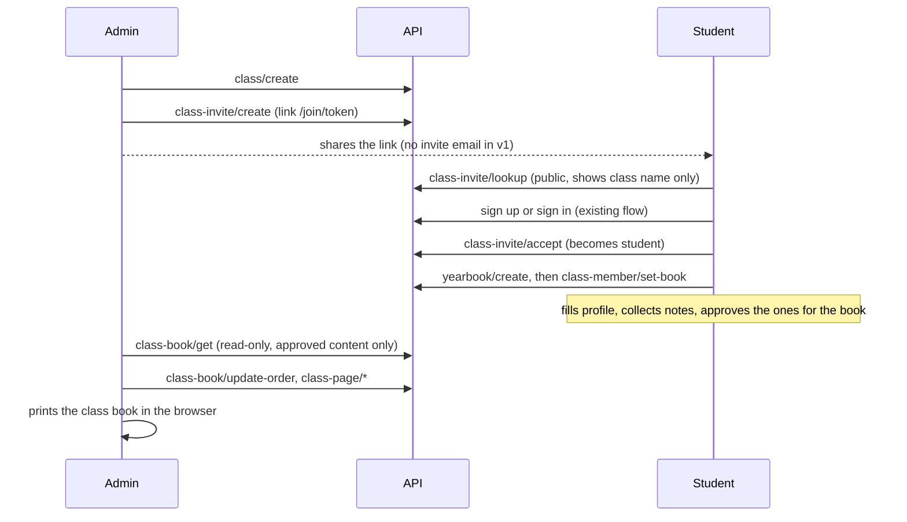

# E07 — Class yearbook: design (leader, 2026-10-26, decision D-36)

Read this first; every E07 task spec points here. It is short on purpose: the simplest design that meets D-36.

## The idea (one paragraph)
A student's page in the class book is **their own personal yearbook** (the machinery that exists today: profile, note links, moderation, photos, quotas). A class is a thin layer on top: `class_tab` (the space), `class_member_tab` (who is in it, with a role, and which of their yearbooks is their class page), `class_invite_tab` (join links) and `class_page_tab` (class-level pages such as intro or teachers). The class book is **assembled on read** from the members' approved content. Nothing in the current ownership checks (`yearbook_tab.owner_id = ?`) changes: the admin never gets rights over a student's yearbook, only a read-only, class-scoped view of what the student has already approved.

Why this and not "many profiles in one yearbook": every store, limiter and quota in `yearbook`, `notes`, `media` keys on one owner and one profile. Changing that touches about ten packages and the audit-hardened code. This design adds new packages and one new media read path.

## Roles and the permission matrix (tested on every endpoint)
| Action | Admin | Student (member) | Other user / anonymous |
|---|---|---|---|
| Create a class (verified email) | yes (becomes admin) | yes (own new class) | no |
| See class name, own role, own page status | yes | yes | no (404) |
| See the roster (names, role, page status counts) | yes | **no** (only own row) | no (404) |
| Create, list, revoke invites | yes | no (403) | no (404) |
| Join with an invite | n/a | yes, becomes student | needs an account first |
| Change a member's role, remove a member | yes (last admin protected) | no | no |
| Leave a class | yes if not the last admin | yes | n/a |
| Read class book data (profiles, approved notes, class pages) | yes | **no** | no |
| Read a student's pending or hidden notes, note-link tokens, unapproved photos | **no** | own only (via the normal yearbook endpoints) | no |
| Edit a student's yearbook | **no** | own only | no |
| Edit class pages, order the book, delete the class | yes | no | no |
Rules: "not a member" and "no such class" both answer 404 (no existence leak). A member without the right role gets 403 `ERROR_FORBIDDEN`. All checks are in SQL joined on `class_member_tab` (user id and role), like the existing `owner_id` checks.

## Data (docs/db-conventions.md applies: `_tab`, BIGINT ms, ULID `public_id`, no foreign keys, expand-only migrations)
- `class_tab(id, public_id, name, school_name, graduation_year, language, created_by, created_at, updated_at)`.
- `class_member_tab(id, class_id, user_id, role ENUM('admin','student'), yearbook_id NULL, sort_order, joined_at)`; unique `(class_id, user_id)`; unique `(yearbook_id)` when set (a yearbook belongs to at most one class).
- `class_invite_tab(id, public_id, class_id, token_hash BINARY(32), created_by, expires_at, revoked_at NULL, created_at)`; only the SHA-256 is stored.
- `class_page_tab(id, public_id, class_id, kind ENUM('intro','teachers','events','superlatives','custom'), title, body, placement ENUM('front','back'), sort_order, created_at, updated_at)`.
- Register the new child-to-parent pairs in `dbtest.orphanPairs`. Deleting a class removes its rows only, never a student's yearbook. Deleting a student's yearbook clears `class_member_tab.yearbook_id` (a `ChildPurger`).

## Limits (named constants)
Classes per user as admin: 10. Members per class: 60. Active invites per class: 5. Invite lifetime: default 14 days, max 30. Class pages per class: 30, body at most 4000 characters. The book keeps its page budget (about 120 pages): per member at most 40 approved notes in the class book.

## Flows

## Non-goals (v1)
Invite emails (docs/email.md says no links in mail), minors, student-to-student visibility, a class cover image, editing a student's page as admin, payments, in-app printing.

## Privacy review (exit criterion, T-131)
Update docs/legal/privacy.*.md and terms.*.md for class data (who sees what), add the class case to the owner's go-live review, and have the owner sign off before production use.
