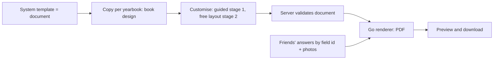
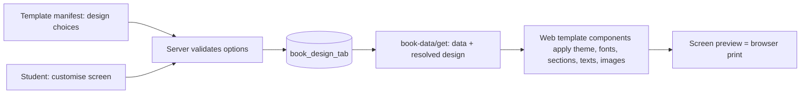

# E09 — Customisation and design editor (Canva-style, staged)

**Status:** stage 1 built and merged 2026-10-30 (T-141..T-148, QA-verified exit check; owner acceptance pending for T-146..T-148); stage 2 sketch   **Milestone(s):** M1b (guided customisation), M4 (free-layout editor)   **Owner decisions:** D-19, D-20, D-21 (README §4)

## Problem and users
Students want their yearbook to look like theirs: move a photo, resize a title, remove a block, add a sticker, replace an image. The owner asked (2026-10-08) for a Canva-like experience: the site provides templates, gathers friends' submissions,
inserts them into the template, each template has its own fields, and the yearbook owner edits the design on the web page: add, remove, resize and replace any component.
Printing and ordering stay outside the app (D-04).

## Goal and non-goals
- Goal (staged, D-19): (1) templates drive the forms and students make guided customisations; (2) after go-live, a free-layout editor on the same document model.
- Non-goals: users publishing templates to other users or a template gallery (D-20), real-time collaboration, native apps, video, AI layout, ordering prints.

## Stages
| Stage | Milestone | What the student can do | Main pieces |
|---|---|---|---|
| 0 | M1 (now) | Pick a system template (E05, E08); friends' forms are template-driven (D-21: T-043, T-034, T-044) | field catalogue, answers by field id, templates declare fields |
| 1 Guided customisation | M1b (after M1 is stable) | Per book: colour and font sets from the template's allowed choices, show/hide/reorder pages, edit titles and static text, swap photos and backgrounds, choose which note fields print | `book_designs` (one design copy per yearbook), customise screen with a PDF preview, validator for design copies |
| 2 Free-layout editor | M4 (own milestone after go-live M2; order against M3 class decided at the M2 retrospective) | Add, remove, move, resize, rotate, replace elements; add text, shapes, stickers and frames from an asset library; layers; undo and redo; snapping and safe margins | canvas editor, asset library, document limits and sanitising, render-parity tests, autosave and versions |

## The document model (the key decision)
The design document of a book is a copy of the template JSON (format v2/v2.1, docs/templates.md), resolved with the student's changes: pages, elements with a box in mm, a slot or fixed text, rotation, fonts and colours from allowed sets.
One format serves all three stages: system templates are documents, a student's book design is a document, the editor edits a document, and the Go renderer (L-12) draws a document into the PDF. The editor may therefore only offer what the renderer can draw.
Slots stay the binding between a document and the data (profile fields, photos, note answers); a student can move or resize a slot element but not invent a data source.

## Scope and requirements (outline, to be specified per stage)
- Stage 1: **superseded by the section "Stage 1 plan" below** (the original outline assumed a server-side PDF render; since D-24 the book is HTML printed by the browser).
- Stage 2: an editor library spike first (MIT-licensed Konva or Fabric.js versus paid SDKs such as Polotno or CE.SDK; paid services need an owner decision, licences to verify at that time); text editing through a DOM text field laid over the canvas (Vietnamese input methods Telex and VNI are the known failure point of canvas editors);
  fonts shipped to the browser from the same files the PDF uses (Vietnamese-capable only, D-18); element palette and property panel; layers; undo and redo; snapping and guides; safe-margin overlay; asset library with licensed, curated stickers and frames (OFL/CC0 or owner-made, licence file per asset); strict validation of every document and asset on the server (limits, allowed asset ids only, SVG not accepted unless sanitised); autosave with versions; parity tests proving that the editor's text fitting and the PDF agree; mobile strategy (phone view-and-light-edit first, full editing on larger screens).
- Non-functional: the export budget of T-014 holds for edited documents; a document never references data the student does not own; accessibility basics (keyboard moves, labels, contrast).

## Flow

## Stage 1 plan (2026-10-30)

**Owner decisions (D-39, D-41).** Guided customisation comes before go-live. First release: colour themes and font pairs, show/hide and reorder sections, edit titles and fixed texts, swap images from a set shipped with the template. Pilot on Memory Book, then Navy Classic. Desktop and tablet first; the phone is usable but basic (controls in one column, move up/down buttons, no drag on small screens).

**What changed from the outline.** Since D-24 / ADR 0003 a template is a set of React page components printed by the browser, not a JSON page description drawn by the Go renderer. So the stage 1 "design" is not a copy of a template document; it is a small set of **choices** the template declares and the web app applies. The screen the student edits is the print render itself, so preview and print agree by construction (the real PDF round trip of the outline is dropped; the print guide and the print-check keep covering the browser side).

**The model.**
- A template manifest (`internal/templates/embed/<id>.json`, `renderer: html`) gets an optional `design` block: `themes` (ids), `font_sets` (ids), `sections` (each with `id`, and whether it is `hideable`, `movable`, or fixed first/last), `texts` (each with `id` and `max` runes) and `images` (each with `id` and the `choices` ids). The web template defines what each id looks like (CSS custom properties for a theme, font stacks for a font set, default text, image files). A test pins web ids to manifest ids.
- One row per yearbook in `book_design_tab` (`yearbook_id`, `template_id`, `options_json` at most 4 KiB, `updated_at`; ULID/BIGINT conventions, no FK): `{"v":1,"theme":"...","fonts":"...","sections":{"order":[...],"hidden":[...]},"texts":{"cover.title":"..."},"images":{"cover.bg":"..."}}`. The server validates every key against the template's manifest; unknown ids are rejected on write and ignored (default) on read. Texts are plain text rendered as React text. Owner-only; the design is not secret, so the class book (T-146) applies each student's design to their own pages.
- Changing the template resets the design (answers and photos survive). Reset-to-template deletes the row.
- `GET /api/book-data/get` carries the resolved design so the print route needs one fetch.
- No uploads of backgrounds, no free text styling, no element-level editing (stage 2).

**Fonts.** Only Vietnamese-capable OFL families (D-18), self-hosted woff2 with a licence file, loaded only when a font set that uses them is active (the print waits for fonts as today).

**Tasks (board, milestone M1b).** T-141 design model and API; T-142 web runtime with themes and fonts (Memory Book pilot); T-143 sections, texts and images in the runtime; T-144 the customise screen; T-145 Navy Classic; T-146 the class book applies each student's design; T-147 end-to-end journey, print-check coverage and docs. Order: 141 → 142 → 143 → 144 → 145 → 146 → 147.

## Risks and open questions
- Screen and PDF can disagree (text wrapping and shrinking). Mitigation: preview is the server-rendered PDF in stage 1; stage 2 shares the layout rules and has parity tests; limit editor effects to what the renderer supports.
- Vietnamese input in canvas editors (stage 2 spike must prove it).
- Phones: canvas editing on small screens is hard; decide the level of support in the stage 2 spec.
- Asset licensing and storage size; user-uploaded images follow the T-009 pipeline.
- Cost: stage 2 is about 20 or more tasks. Owner questions to raise at stage 2 start: editor SDK versus building on Konva/Fabric (cost, licence), mobile support level, asset library source, version retention, and whether M4 goes before the class yearbook (M3).
- D-12 stays (pure-Go PDF). Revisit only if the editor needs effects the renderer cannot draw (then a headless-browser renderer would need its own decision: memory, sandboxing, cost).

## Exit criteria ("stable" for this epic)
- Stage 1 (**met 2026-10-30**: T-147 journey `tools/e2e/design.spec.mjs` plus QA's hand check on Memory Book and Navy Classic; follow-up T-148 guards the Back button): a student customises colours, fonts, page order and visibility of their book, sees the PDF preview, resets to the template, and the export matches the preview; existing notes and photos survive a template change.
- Stage 2: a student adds, removes, moves, resizes and replaces elements in the browser on desktop and tablet, types Vietnamese correctly, undoes and redoes, and the exported PDF matches the editor in an automated parity test.

## Task index
Stage 1 tasks: T-141 .. T-148 (T-148 is the leave-guard follow-up) (specs `01-..` to `07-..` in this folder). The foundation tasks of this direction are in other epics: T-043 (field catalogue), T-034 (answers by field id), T-044 (templates declare fields), T-038 (format v2). Stage 2 tasks are specified when M4 becomes "Now" (README §2).
