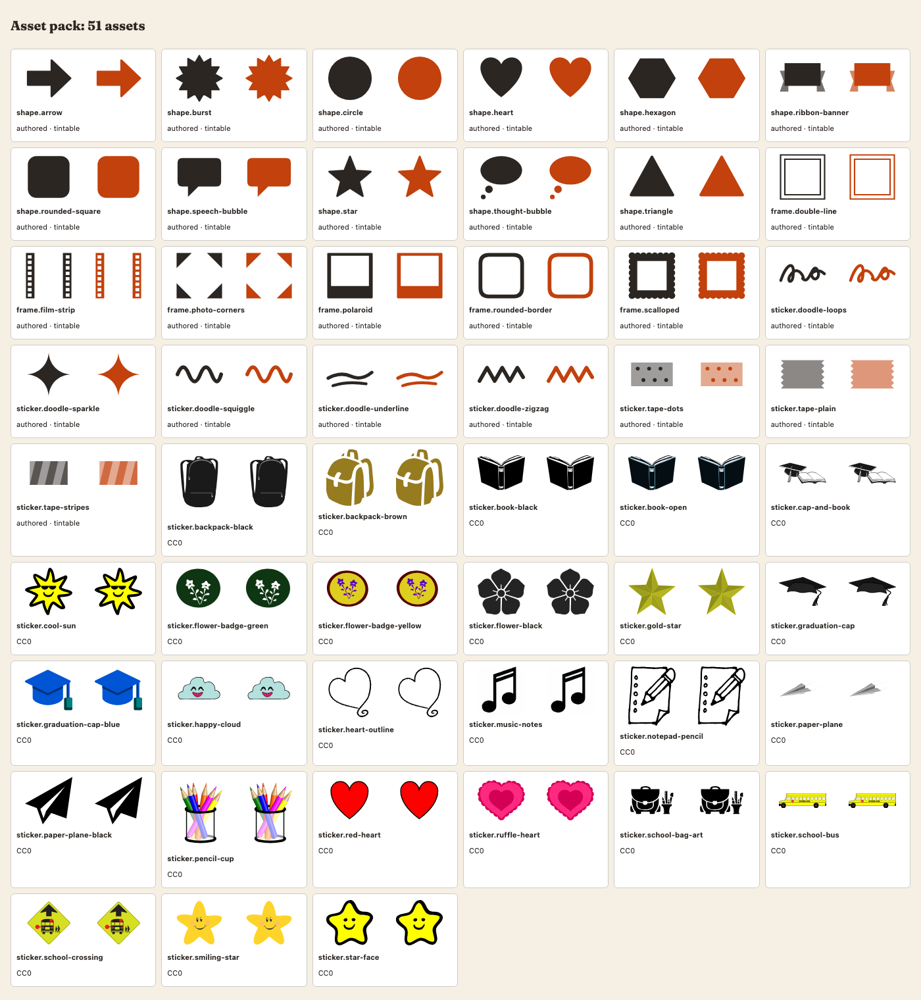

# Asset pack: stickers, shapes and frames

The free-layout editor of epic E09 (decisions D-42 and D-43) lets a student add stickers, shapes and frames. They come from one pack that we
curate, and the server accepts only ids from that pack. Built in T-151; the editor and the layout model come later.

## Layout

| Path | What |
| --- | --- |
| `web/src/book/assets/registry.json` | The list of every asset (the source of truth). |
| `web/src/book/assets/svg/<id>.svg` | One plain SVG per asset. |
| `web/src/book/assets/licences/` | `authored.txt` for the drawn assets, one `<id>.txt` per curated asset (source, author, licence, date, changes). |
| `web/src/book/assets/index.tsx` | `assets`, `getAsset(id)`, `loadSvg(id)` and `<AssetSvg id tint size label />`. |
| `web/src/book/assets/kind-*.ts` | One lazy module per kind; the SVG text of a kind is loaded when the first asset of that kind is drawn. |
| `internal/assets/registry.json` | Byte copy of the registry that the Go server embeds (`assets.Has(id)`, `assets.Get(id)`, `assets.All()`). |
| `web/scripts/check-assets.mjs`, `scripts/check-assets.sh` | The safety and registry check (CI `web` job, `make web-lint`). |
| `scripts/sync-assets.sh` | Copies the registry to `internal/assets/`. |

The pack has 51 assets: 34 stickers, 11 shapes, 6 frames. 25 are authored by the team (licence `authored`, placed under CC0) and 26 are
curated CC0 stickers.

## Registry entry

`id` (`kind.name`, lowercase, stable: layouts store it, never rename or reuse one), `kind` (`sticker`, `shape`, `frame`), `file`
(`svg/<id>.svg`), `label_en`, `label_vi`, `tags`, `tintable`, `width` and `height` (the viewBox, always `0 0 width height`), `licence`
(`CC0`, `OFL` or `authored`), `licence_file`, `source_url` (https, empty for `authored`), `author`, `date_checked` (`YYYY-MM-DD`).

`tintable: true` means the SVG paints with `currentColor` only, so the editor's colour choice (CSS `color`, the `tint` prop of `<AssetSvg>`)
recolours it. A curated sticker keeps its own colours (`tintable: false`, no `currentColor`). Frames are drawn on a 100 x 100 box with a hollow
middle; the editor stretches them to the photo.

## Rules for an SVG

Plain shapes only: `svg`, `g`, `path`, `circle`, `ellipse`, `rect`, `line`, `polyline`, `polygon`. No `script`, `foreignObject`, `style`,
`text`, `image` or `use`; no event attributes, no `href`, no `class`, `style` or `id` attributes, no `url(...)` (so no gradients, filters or
clip paths), no `@import`, no `data:` or `javascript:`; a `viewBox`; at most 20 KB. The SVGs are turned into React elements by `<AssetSvg>`
(never `dangerouslySetInnerHTML`), and the server never accepts an SVG from a user: a layout names a registry id and nothing else.

## Licence rules

Only **CC0 / public domain** or the **SIL OFL**, from a source that states the licence on the page of the asset. Not allowed: CC BY, CC BY-SA,
any NC or ND licence, "free for personal use", or an asset whose licence you cannot verify (draw a replacement instead). Keep the original
licence text in `licences/` and record `source_url`, `author` and `date_checked` (the day you read the licence on the source page).

## Adding an asset

1. Draw or download the SVG; reduce it to the allowed elements (move `style="..."` into attributes, drop metadata, gradients and filters; for a
   drawn asset use `currentColor` and set `tintable: true`). Save it as `svg/<kind>.<name>.svg`.
2. Add the licence file (copy an existing `licences/<id>.txt` and fill it in; drawn assets use `licences/authored.txt`).
3. Add the entry to `registry.json` (both labels are required), keep the file formatted (`cd web && npx prettier --write src/book/assets`).
4. Run `scripts/sync-assets.sh`, then `scripts/check-assets.sh`, `cd web && npm test` and `go test ./internal/assets/`.
5. Look at the page `/dev/assets` in `npm run dev` (every asset, plain and tinted).

## How the server uses it

`internal/assets` embeds the registry. The layout validation (a later task of E09) calls `assets.Has(id)` for every sticker, shape, frame or
background id in a document and rejects the rest. `TestRegistryMatchesWeb` (Go) and the registry test in `assets.test.tsx` (web) fail when the
two copies differ, so a forgotten `scripts/sync-assets.sh` cannot reach `develop`.

## Sources used

- Authored: drawn by the SMemories team in T-151, `licences/authored.txt` (CC0 dedication).
- Openclipart (https://openclipart.org), every clip CC0 1.0: the clip page states the licence and https://openclipart.org/share says all
  clipart is released into the public domain under CC0. Read on 2026-10-31. Normalised (metadata, styles, unused definitions removed) and
  otherwise unchanged:

| Id | Name | Author | Source |
| --- | --- | --- | --- |
| `sticker.backpack-black` | Backpack (black) | elconomeno_email_com | [openclipart.org/detail/345846](https://openclipart.org/detail/345846) |
| `sticker.backpack-brown` | Backpack | Manuela | [openclipart.org/detail/348211](https://openclipart.org/detail/348211) |
| `sticker.book-black` | Open book (black) | nerdy | [openclipart.org/detail/355399](https://openclipart.org/detail/355399) |
| `sticker.book-open` | Open book | nerdy | [openclipart.org/detail/355257](https://openclipart.org/detail/355257) |
| `sticker.cap-and-book` | Graduation cap and book | oksmith | [openclipart.org/detail/298034](https://openclipart.org/detail/298034) |
| `sticker.cool-sun` | Cool sun | SunKing2 | [openclipart.org/detail/290473](https://openclipart.org/detail/290473) |
| `sticker.flower-badge-green` | Flower badge (green) | yamachem | [openclipart.org/detail/217528](https://openclipart.org/detail/217528) |
| `sticker.flower-badge-yellow` | Flower badge (yellow) | yamachem | [openclipart.org/detail/218391](https://openclipart.org/detail/218391) |
| `sticker.flower-black` | Flower | yamachem | [openclipart.org/detail/217517](https://openclipart.org/detail/217517) |
| `sticker.gold-star` | Gold star | mazeo | [openclipart.org/detail/215675](https://openclipart.org/detail/215675) |
| `sticker.graduation-cap` | Graduation cap | Iyo | [openclipart.org/detail/349012](https://openclipart.org/detail/349012) |
| `sticker.graduation-cap-blue` | Graduation cap (blue) | Tipigao | [openclipart.org/detail/349851](https://openclipart.org/detail/349851) |
| `sticker.happy-cloud` | Happy cloud | Mahua_Sarkar | [openclipart.org/detail/281571](https://openclipart.org/detail/281571) |
| `sticker.heart-outline` | Heart outline | nerdy | [openclipart.org/detail/355481](https://openclipart.org/detail/355481) |
| `sticker.music-notes` | Music notes | Artster_Time | [openclipart.org/detail/350524](https://openclipart.org/detail/350524) |
| `sticker.notepad-pencil` | Notepad and pencil | j4p4n | [openclipart.org/detail/320383](https://openclipart.org/detail/320383) |
| `sticker.paper-plane` | Paper plane | monsterbraingames | [openclipart.org/detail/218712](https://openclipart.org/detail/218712) |
| `sticker.paper-plane-black` | Paper plane (black) | azisher | [openclipart.org/detail/248175](https://openclipart.org/detail/248175) |
| `sticker.pencil-cup` | Pencils in a cup | hsayin32 | [openclipart.org/detail/178987](https://openclipart.org/detail/178987) |
| `sticker.red-heart` | Red heart | nerdy | [openclipart.org/detail/355535](https://openclipart.org/detail/355535) |
| `sticker.ruffle-heart` | Ruffled heart | pixabella | [openclipart.org/detail/21617](https://openclipart.org/detail/21617) |
| `sticker.school-bag-art` | School bag and art tools | GDJ | [openclipart.org/detail/242115](https://openclipart.org/detail/242115) |
| `sticker.school-bus` | School bus | schoolfreeware | [openclipart.org/detail/308860](https://openclipart.org/detail/308860) |
| `sticker.school-crossing` | School crossing sign | bnsonger47 | [openclipart.org/detail/196491](https://openclipart.org/detail/196491) |
| `sticker.smiling-star` | Smiling star | GDJ | [openclipart.org/detail/286833](https://openclipart.org/detail/286833) |
| `sticker.star-face` | Yellow star face | SunKing2 | [openclipart.org/detail/290468](https://openclipart.org/detail/290468) |

Kenney (https://kenney.nl, CC0) was looked at but not used: its downloads sit behind a script-driven form and no asset was needed from it.
